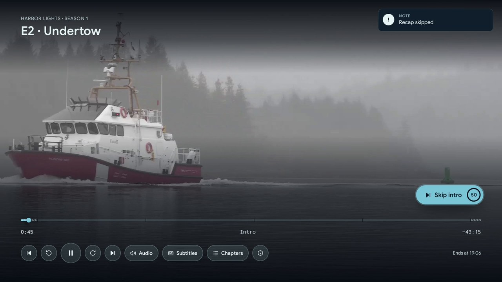
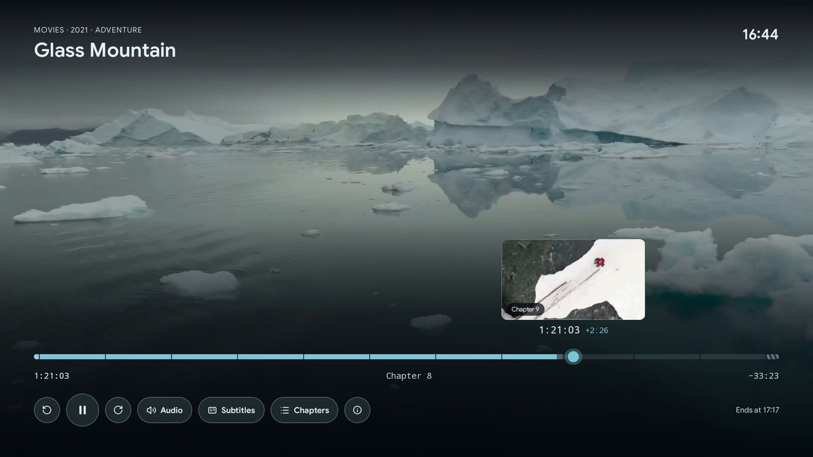
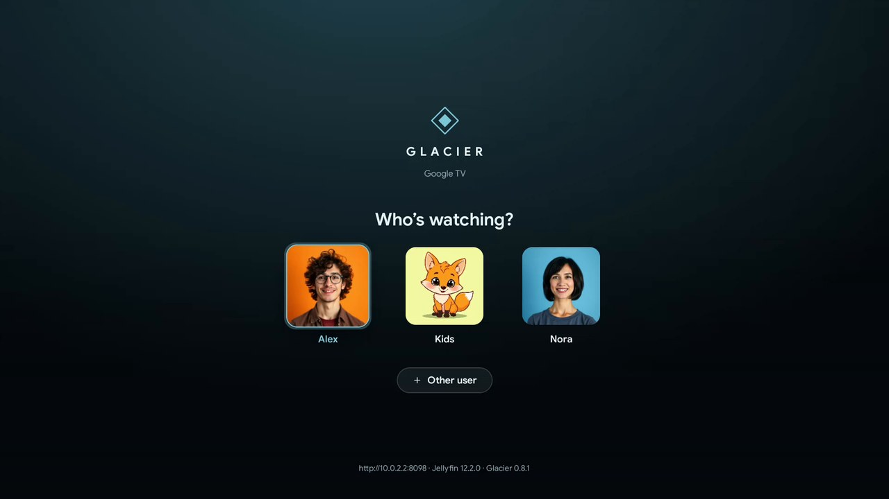
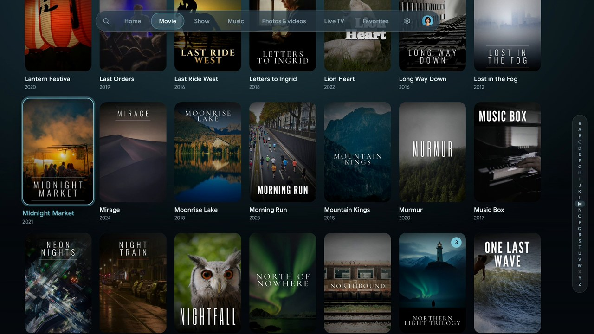
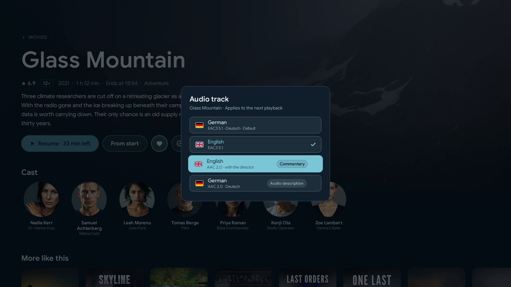
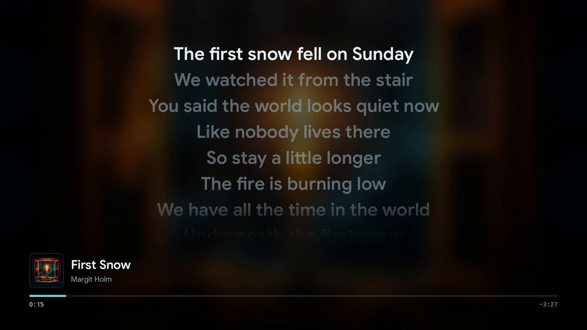
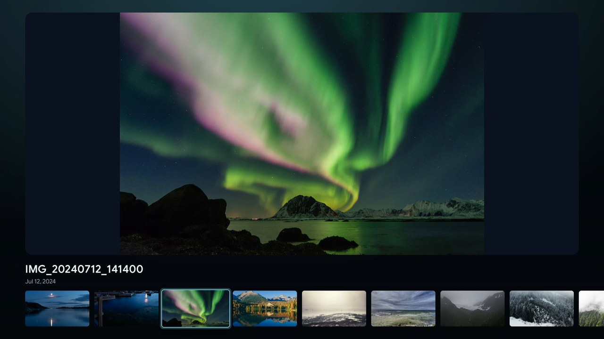
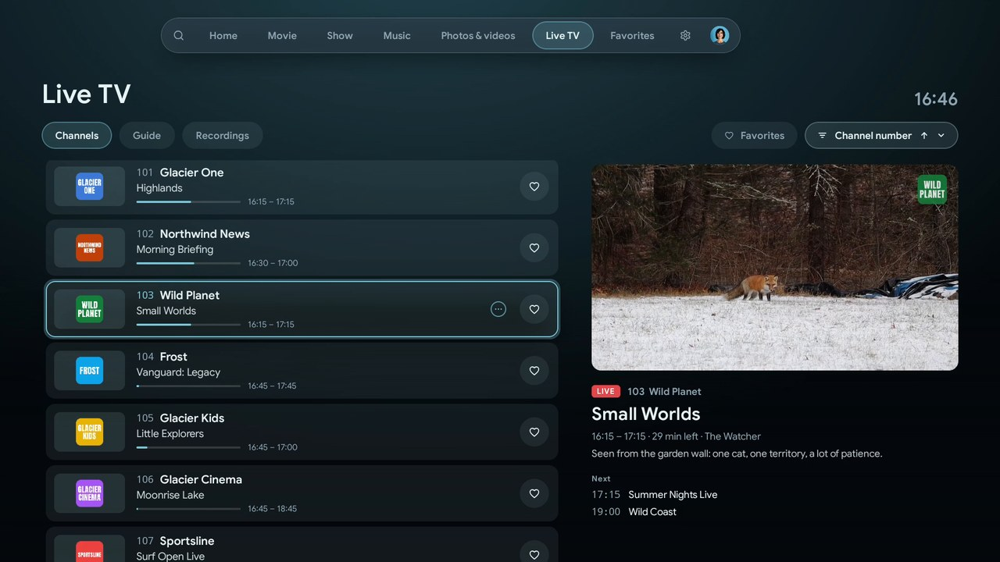

<p align="center">
  <br>
  
  <br>
  <br>
</p>

<h3 align="center">The TV is yours again.</h3>

<p align="center">
  Glacier brings your Jellyfin server to Android TV, Google TV and Fire TV.<br>
  Built for the remote, with the sound and picture your files really have.
</p>

<p align="center">
  <a href="https://www.amazon.com/dp/B0HPL2YVVQ"></a>
  <a href="#become-a-tester-on-google-play"></a>
  <a href="https://github.com/Glacier-Jellyfin/glacier-androidtv/releases/latest/download/glacier-androidtv.apk"></a>
</p>

<p align="center">
  <a href="https://glacier-jellyfin.github.io/glacier-androidtv/">Website</a> ·
  <a href="#installation">Installation</a> ·
  <a href="CHANGELOG.md">Changelog</a> ·
  <a href="https://github.com/Glacier-Jellyfin/glacier-androidtv/issues">Report a bug</a>
</p>

<p align="center">
  <a href="https://github.com/Glacier-Jellyfin/glacier-androidtv/releases/latest"></a>
  <a href="https://github.com/Glacier-Jellyfin/glacier-androidtv/releases"></a>
  <a href="https://github.com/Glacier-Jellyfin/glacier-androidtv/actions/workflows/ci.yml"></a>
  <a href="https://scorecard.dev/viewer/?uri=github.com/Glacier-Jellyfin/glacier-androidtv"></a>
  <a href="https://www.bestpractices.dev/projects/16652"></a>
  <a href="LICENSE"></a>
</p>

<p align="center">
  
</p>

> [!NOTE]
> Glacier is young and still growing. If something does not work, please
> [report it](https://github.com/Glacier-Jellyfin/glacier-androidtv/issues).

## What Glacier does differently

<p align="center">
  
  
  
</p>

**For the system under the TV.** TrueHD and DTS-HD reach your receiver exactly
as they are on the disc, even where Android only passes the DTS core or gives
up on TrueHD. If nothing gets through, the server converts to E-AC-3 and
surround stays.

**For the TV itself.** Dolby Vision plays even from UHD Blu-rays with profile
7, converted on the device. The TV switches to the frame rate of the film, and
Settings › System › Check playback tests with real files what your TV can
play.

**For everyone on the sofa.** Everyone gets a profile with their own picture,
colour and progress. The kids profile only shows what suits their age, and the
PIN goes in with the D-pad. The settings come along to a new TV.

## What the remote does

<p align="center">
  
  
</p>

- OK skips the intro, and recaps skip themselves. Credits can skip too
- Seeking shows preview pictures, so you land on the right scene. Chapters are
  one press away
- The next episode is ready before the credits end, with a countdown that can
  shrink out of the way
- The A–Z rail jumps straight to the letter. Large libraries open fast, and
  sorts by year, date added or artist show a heading over each group
- A title's page names every audio and subtitle track in full, with region,
  flag and marks for forced, commentary, audio description or sing-along
- Several versions of a title, such as 2160p and 1080p or a director's cut,
  with the right one picked for your TV and your pick kept per movie or show

## The shelf next to it

<p align="center">
  
  
  
</p>

- **Music** that keeps playing while you browse: a mini player, a full screen
  with large lyrics, queue, playlists, instant mix and music videos mixed in
  with the songs
- **Photos and home videos** by folder, as cards or a gallery, full screen with
  a slideshow on OK
- **Live TV** with a running preview on every channel, a programme guide,
  recordings of programmes and series, pause and rewind, and radio stations
  that play like music

## The small print

- Search also finds titles missing from your library and requests them
  through Seerr (needs the Jellyfin Enhanced plugin on the server)
- Multiple servers and profiles, server discovery and Quick Connect. A start
  profile can open by itself
- Parental controls with age limits and PINs for profiles, titles and
  settings, stored only on the device
- Local and YouTube trailers with subtitles, and theme songs on detail pages
- A Favorites page with everything you marked with the heart, in the rows you
  pick
- Audio and subtitle preferences synced with your Jellyfin account
- Android TV home screen: "Watch next" and three optional channels (not on
  Fire TV)
- English, German and Spanish user interface, accent colours and a compact layout
- When playback fails, the message names the error and shows a QR code to
  download the log for a bug report. Settings › System also sends a cleaned
  log to your server
- Built-in updates for the GitHub version, with a Stable and a Beta channel

## Requirements

| | |
|---|---|
| Device | Android TV, Google TV or Fire TV running Android 9 (API 28) or newer |
| Server | Jellyfin 12.0 or newer |

## Installation

Glacier is free and needs no account.

### On your TV in two minutes


1. Install the free [Downloader](https://www.aftvnews.com/downloader/) app from
   the app store on your TV.
2. Open it, enter the code **2423112** and allow the install.
3. Done. The code always loads the newest version, and from then on Glacier
   keeps itself up to date.

### From a store

<a href="https://www.amazon.com/dp/B0HPL2YVVQ"></a>
<a href="#become-a-tester-on-google-play"></a>

The Amazon Appstore has Glacier for Fire TV, and the store keeps it up to
date like any other app. Google Play is in closed testing.

### Become a tester on Google Play

> [!TIP]
> Google publishes apps from new personal developer accounts only after a
> closed test with at least 12 testers over 14 days. If you have an Android TV
> or Google TV, you can be one of them:
>
> 1. Join the [tester group](https://groups.google.com/g/glacier-jellyfin-client-testers)
>    with the Google account you use on your TV.
> 2. [Opt in to the test](https://play.google.com/apps/testing/io.github.glacier_jellyfin.androidtv)
>    with the same account.
> 3. Open the Play Store on your TV and install Glacier. It can take a few
>    minutes until it shows up.

### As an APK

<a href="https://github.com/Glacier-Jellyfin/glacier-androidtv/releases/latest/download/glacier-androidtv.apk"></a>

Download
[`glacier-androidtv.apk`](https://github.com/Glacier-Jellyfin/glacier-androidtv/releases/latest/download/glacier-androidtv.apk)
and sideload it, for example with `adb install glacier-androidtv.apk`. All
versions are on the [releases page](https://github.com/Glacier-Jellyfin/glacier-androidtv/releases).

<details>
<summary><b>Updates</b></summary>

Installed from GitHub, Glacier keeps itself up to date. It checks for new versions
at every start and installs them from GitHub releases. Android asks once for
permission to install updates from Glacier. You can pick the Stable or Beta
channel in Settings › System.

</details>

<details>
<summary><b>Checking a download</b></summary>

Every release is built on GitHub from the source code in this repository and
carries a signed build provenance attestation. With the
[GitHub CLI](https://cli.github.com/) you can check that your APK came from
here:

```sh
gh attestation verify glacier-androidtv.apk --repo Glacier-Jellyfin/glacier-androidtv
```

</details>

## Building

Requirements: JDK 17 or newer and the Android SDK (Android Studio installs it).

```sh
./gradlew assembleDebug        # debug APK in app/build/outputs/apk/debug/
./gradlew testDebugUnitTest    # unit tests
```

See [docs/ARCHITECTURE.md](docs/ARCHITECTURE.md) for the module layout and
[docs/RELEASING.md](docs/RELEASING.md) for versioning and releases.

## How I build Glacier

Glacier is a hobby project. I work as a software developer, and next to my
job I use Glacier to find out how to build software together with AI.

I want to be open about what that means. Almost all code, tests and
documentation are written with
[Claude Code](https://claude.com/claude-code), Anthropic's coding assistant,
working together with me. Every commit it worked on says so with a
`Co-Authored-By: Claude` line, and today that is nearly every commit.

I decide what Glacier does and how it looks and feels. I review the changes
and test them on my own TVs and the Android TV emulator before they ship. On
top of that, every change goes through lint, unit tests and security scans in
CI, and releases are built only by GitHub from the public source code.

Glacier itself has no AI features and sends nothing to AI services. AI makes
mistakes, and so do I. If something looks wrong, please
[tell me](https://github.com/Glacier-Jellyfin/glacier-androidtv/issues).

## Contributing

Bug reports, ideas, pull requests and translations are welcome. Please read
[CONTRIBUTING.md](CONTRIBUTING.md) first.

## Support

Glacier is built in spare time and stays free. If it makes your evenings a
little better, a coffee on Ko-fi keeps it going.

<a href="https://ko-fi.com/jeansy91"></a>

## License

Glacier is licensed under the [GNU General Public License v3.0 or later](LICENSE).
Third-party parts (fonts, flags, the Media3 decoder module and others) keep their own
licences, listed in [REUSE.toml](REUSE.toml) with the texts in [LICENSES/](LICENSES/).

Glacier is an independent project and is not affiliated with the Jellyfin project.
Amazon, Amazon Appstore and the Amazon logo are trademarks of Amazon.com, Inc. or
its affiliates. Google Play and the Google Play logo are trademarks of Google LLC.
